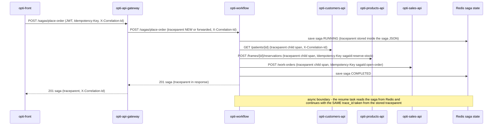

# CP1 - Critical journey and trace map: `place-order`

**Journey:** a seller opens a quotation for an active patient and a frame. It crosses
`opti-api-gateway`, `opti-workflow` (saga `place-order`), `opti-customers-api`, `opti-products-api`
and `opti-sales-api`, and it is the only journey that writes in three databases.
Source: `opti-workflow/README.md`, `opti-api-gateway/README.md`, `opti-sales-api/README.md`.

## Hop table

| Step | Caller | Callee | Protocol | Operation | Sync/Async | Data |
|---|---|---|---|---|---|---|
| 1 | `opti-front` (sales portal) | `opti-api-gateway` | REST | `POST /api/v1/sagas/place-order` | sync | none |
| 2 | `opti-api-gateway` | `opti-workflow` | REST | `POST /api/v1/sagas/place-order` (`Idempotency-Key`) | sync | Redis `saga-key:*` |
| 3 | `opti-workflow` | `opti-customers-api` | REST | `GET /api/v1/patients/{id}` (step `check-patient`) | sync | `customers.patient` |
| 4 | `opti-workflow` | `opti-products-api` | REST | `POST /api/v1/frames/{id}/reservations` (step `reserve-stock`) | sync | `products.stock_reservation`, `products.stock_movement` |
| 5 | `opti-workflow` | `opti-sales-api` | REST | `POST /api/v1/work-orders` (step `open-order`) | sync | `sales.work_order`, `sales.work_order_item`, `sales.invoice`, `sales.idempotency_key` |
| 6 | `opti-workflow` resume task | `opti-workflow` | in-process, via Redis state | resumes a saga left `RUNNING` after `SAGA_RESUME_AFTER` | **async** | Redis `saga-key:*` |

**Critical hop (used again in CP9): step 4, `reserve-stock` on `opti-products-api`.** It is the
only step with a compensation that matters to money (the reserved frame is not for sale), and the
one that refuses most often (`INSUFFICIENT_STOCK`).

## Sequence diagram

`traceparent` is the W3C header `00-<trace_id>-<span_id>-01`. Every arrow shows what travels.



## Span tree

Names are `<service> <operation>`. Same `trace_id` everywhere.

```
opti-api-gateway  POST /api/v1/sagas/place-order                 (root span, created by the gateway)
  opti-workflow  POST /api/v1/sagas/place-order                  (child)
    opti-workflow  saga.step check-patient
      opti-customers-api  GET /api/v1/patients/{id}
    opti-workflow  saga.step reserve-stock                       (critical hop)
      opti-products-api  POST /api/v1/frames/{id}/reservations
    opti-workflow  saga.step open-order
      opti-sales-api  POST /api/v1/work-orders
  opti-workflow  saga.resume                                     (ASYNC boundary: later, other thread,
                                                                  parent = stored span, same trace_id)
```

## How the context travels today and what is missing

| Where | Today (checked in the repos) | Needed for this journey |
|---|---|---|
| gateway to workflow | `X-Correlation-Id` is reused or created and forwarded | forward `traceparent` too (one `proxy_set_header` in `nginx/routes`) |
| workflow to participants | `Correlation` reads the id from MDC and sends `X-Correlation-Id` | also send `traceparent` with a child span (`ParticipantClient`) |
| async resume | the saga JSON in Redis has no trace data | store `traceparent` when the saga starts and use it in the resume task |
| collector | `opti-infra/observability/otel-collector.yaml` receives OTLP, traces go to `debug` only | services export OTLP; add a trace backend later |

The working code of `03-instrumentation/` implements the workflow side of the second row.
