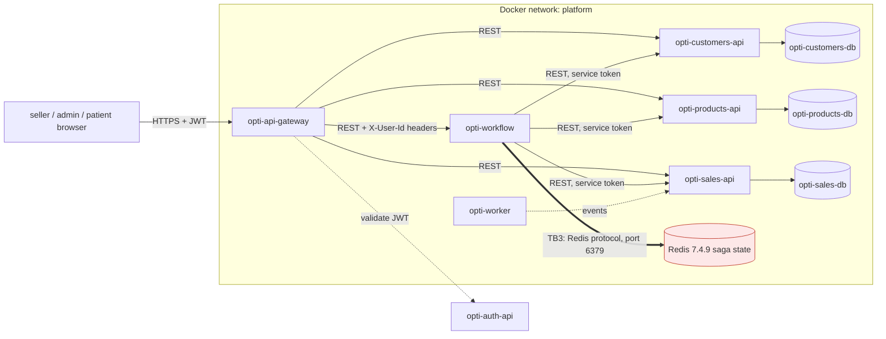

# CP1 - Attack surface map

Sources: `opti-docs` ADR-003 (database per service), ADR-004 (orchestrated `place-order` saga),
ADR-005 (outbox, `opti-worker`), `07-api/authentication.md` (gateway headers), and `opti-infra/compose.yml`.
My boundary is **TB3**: `opti-workflow` to Redis.

Trust boundaries: TB1 browser to `opti-api-gateway` (internet to platform); TB2 gateway to each service
(inside the `platform` network, services trust the gateway headers); **TB3 `opti-workflow` to Redis (mine)**;
TB4 `opti-workflow` to the participant APIs (service token).

## Asset inventory
| Asset | Where it lives | Classification |
|---|---|---|
| Saga state (`saga:<id>`, JSON per saga, kept 30 days) | Redis, volume `redis-data` | Confidential (carries the caller identity and the order data) |
| Idempotency key (`saga-key:<key>`) | Redis | Internal |
| Saga lease (`saga-lock:<id>`) and active set (`sagas:active`) | Redis | Internal |
| Service credential (`SERVICE_TOKEN`) | environment of `opti-workflow` | Restricted |
| Patient data (name, document) | `opti-customers-db` | Confidential |
| Stock reservations | `opti-products-db` | Internal |
| Work orders | `opti-sales-db` | Confidential |

TODO before committing: open `RedisSagaStore` / the saga JSON and confirm which fields are really stored
(patient id only, or also name and document). That decides the classification of the first row.

## Entry points of TB3
| Entry point | Who calls it | How it authenticates today |
|---|---|---|
| Redis TCP 6379 (`expose`, not published to the host), network `platform` | `opti-workflow` (`RedisSagaStore`, Spring Data Redis) | None: `redis-server --appendonly yes`, no `requirepass`, no ACL, no TLS (`opti-infra/compose.yml`) |
| Redis volume `redis-data` (append-only file) | the Docker host | Host file permissions |
| `healthcheck: redis-cli ping` | Docker | None |

## CP1 reflection entry (to write by hand in the Google Doc)
What I learned / how it applies to `opti-workflow` and Redis / what I would fix first and what blocks it.
