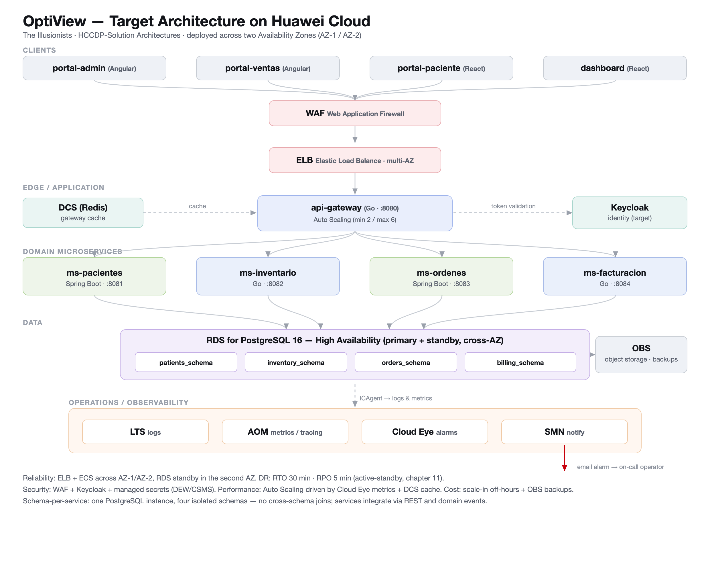

# Architecture design note — The Illusionists

## 1. Target architecture

| Component in the diagram | Defined in (file of your team's -docs) |
|---|---|
| api-gateway (Go, :8080) | 05-architecture/overview.md |
| ms-pacientes (Spring Boot, :8081) | 05-architecture/overview.md, 06-data/models.md |
| ms-inventario (Go, :8082) | 05-architecture/overview.md, 06-data/models.md |
| ms-ordenes (Spring Boot, :8083) | 05-architecture/overview.md |
| ms-facturacion (Go, :8084) | 05-architecture/overview.md |
| PostgreSQL 16 (patients/inventory/orders/billing schemas) | 06-data/models.md |
| Keycloak (identity, target) | 05-architecture/overview.md, 07-api/authentication.md |

OptiView is a management platform for an optical store. Its target architecture is a set of
four domain microservices behind a single `api-gateway`, with identity delegated to Keycloak,
following the C4 container diagram in `05-architecture/overview.md`. Today the system is
delivered as **Cut 1**, a modular monolith (one Spring Boot backend plus one React frontend)
that implements the patients, inventory and orders domains as packages in a single process.
This note takes that real architecture and describes how it would be hardened and operated on
Huawei Cloud, using the design techniques from the HCCDP-Solution Architectures course.

The reason the note is written against the *target* architecture rather than the Cut 1 monolith
is that the course's design methods — reliability, security, performance, cost and operations as
five explicit concerns, horizontal scalability, disaster recovery and automated deployment — only
become meaningful once the system is distributed. The monolith is a single process on a single
host, so questions such as "which service scales first" or "what fails over when an Availability
Zone is lost" have no answer yet. By mapping each of OptiView's documented weaknesses (recorded as
technical debt AT-001 to AT-004 in `05-architecture/overview.md` §8) to a concrete Huawei Cloud
service, the note doubles as a migration plan: it states not only what the architecture should
look like, but which managed service closes each specific gap and why that choice is appropriate
for a single-store optical business rather than a large enterprise. Every row in the sections
below cites the exact file in the team's `-docs` where the weakness is documented, so the design
decisions can be traced back to real evidence instead of being asserted.

The Cut 1 monolith is not discarded by this design. The four domain packages inside today's
single Spring Boot backend (`model/patient`, `model/frame`, `model/workorder`) map one-to-one
onto the target services, and the team's own `optiview-platform` ADR-0001 records that
equivalence. The services also correspond to real repositories: `ms-pacientes` to the
`opti-customers-*` trio, `ms-inventario` to `opti-products-*`, and `ms-ordenes` plus
`ms-facturacion` to the shared `opti-sales-*` trio (see the service-to-repository table in
`05-architecture/overview.md` §4). Hardening the system therefore means extracting these
packages into independently deployable services and placing them behind the managed Huawei Cloud
building blocks described below — not rewriting the domain logic — which keeps the migration
incremental and low-risk, in line with the planned evolution in `overview.md` §9 (extract
`ms-inventario` first, as the domain with the fewest cross-dependencies).

## 2. Five principles

The course frames architecture as five concerns that must be weighed together rather than
optimised in isolation. The table below applies that lens to OptiView: each row names a
principle, the concrete weakness that exists today (with the file that documents it), the design
decision that addresses it, and the Huawei Cloud service that implements the decision. The
weaknesses are not hypothetical — four of them are already registered as technical debt
(AT-001 to AT-004 in `overview.md` §8), so the mapping doubles as a prioritised remediation list
rather than a wish list.

| Principle | Current weakness | Evidence in -docs | Design decision | Huawei Cloud service |
|---|---|---|---|---|
| Reliability | Single Docker host per environment: one node is a single point of failure, one PostgreSQL instance with no standby | 05-architecture/deployment.md §1, §5 | Deploy services on ECS across two AZs behind a load balancer; use a managed database with a cross-AZ standby instead of a self-managed instance | ELB + ECS (multi-AZ) + RDS for PostgreSQL (HA) |
| Security | Own JWT instead of Keycloak; secrets kept in a git-ignored `.env` with placeholder values; no WAF in front of the gateway | 05-architecture/overview.md §7, deployment.md §5, technical debt AT-003 | Move tokens to Keycloak, store secrets in a managed secrets service, and put a web application firewall in front of the public gateway | DEW/CSMS (secrets) + WAF + Keycloak on ECS |
| Performance efficiency | Fixed 1 replica per service, no autoscaling; no cache for the gateway's hot reads | deployment.md §5, overview.md §4 (Redis "Planned") | Add horizontal autoscaling driven by CPU/latency metrics and a managed Redis for gateway caching | Auto Scaling (AS) + Cloud Eye (CES) + DCS for Redis |
| Cost | One deployment per optical store, provisioned for peak and always on; backups, if any, live on the same host | 05-architecture/deployment.md §1, 01-context/scope.md | Use pay-per-use elasticity (scale to the minimum off-hours) and move backups/artifacts to object storage instead of block storage on the host | AS (scale-in) + OBS (backups) |
| Operations | No structured observability: no central logs, metrics or tracing; failures are debugged by hand | overview.md §5 P4, technical debt AT-002 | Centralise logs, metrics and alarms so an operator is notified before users are | LTS (logs) + AOM (metrics/tracing) + CES + SMN (alarms) |

## 3. Scalability

| Service | Scaling metric | Threshold (number and unit) | Min instances | Max instances |
|---|---|---|---|---|
| api-gateway | Average CPU utilisation | Scale out at > 70% for 3 min, scale in at < 30% for 10 min | 2 | 6 |
| ms-ordenes | Pending requests / average CPU | Scale out at > 75% CPU for 5 min | 1 | 4 |

`api-gateway` keeps a minimum of two instances because it is the only public entry point and
must survive the loss of one AZ. `ms-ordenes` is the write-heavy path (creating work orders,
reading patient and frame data), so it is the first domain service to benefit from autoscaling;
the remaining services stay at a fixed size until their load justifies the same treatment.
Thresholds use a short scale-out window and a long scale-in window to avoid flapping, following
the highly-scalable-system design guidance (course chapter 10). The other three services
(`ms-pacientes`, `ms-inventario`, `ms-facturacion`) are intentionally left at a fixed single
instance in this first iteration: their load is read-dominated and low at a single-store scale,
so autoscaling them would add cost and operational surface before any measured need. Scaling is
driven by Cloud Eye (CES) metrics feeding an Auto Scaling group, which means the same metric
pipeline that raises operational alarms (section 2, operations) also drives capacity — a single
source of truth for how the system is behaving, rather than two parallel monitoring systems.

## 4. Disaster recovery

- Critical data store: **PostgreSQL 16** — specifically `patients_schema` and `billing_schema`,
  whose loss would destroy clinical and financial records (soft-deleted, never hard-deleted —
  06-data/models.md §3).
- RTO: **30** minutes
- RPO: **5** minutes
- DR pattern (chapter 11): **Active-standby across two Availability Zones** with an automatically
  promoted database replica, plus daily full backups retained in object storage.
- Why the pattern meets those numbers: a synchronous/near-synchronous cross-AZ standby keeps the
  replica within a few seconds of the primary, so a failover loses at most the last few minutes
  of transactions (RPO 5 min); promotion plus redirecting the services through the load balancer
  is an automated operation that completes well inside half an hour (RTO 30 min).

Operationally, a failover runs as a defined sequence rather than an improvised one: Cloud Eye
detects that the primary database is unhealthy and raises an alarm through SMN; RDS promotes the
cross-AZ standby to primary; the services, which reach the database through a stable endpoint,
reconnect without any configuration change; and the load balancer keeps routing client traffic to
the healthy ECS instances in the surviving Availability Zone. Daily full backups in OBS, together
with point-in-time recovery, cover the separate case of logical corruption or an accidental write,
where a hot standby alone would simply replicate the bad change. The two mechanisms protect
against different failure modes — hardware/AZ loss versus data corruption — and both are required;
neither substitutes for the other.

## 5. Automated deployment

| Stage | Trigger | Tool or service | File in your team's repositories |
|---|---|---|---|
| Build | Push / merge to a service repo | CodeArts Pipeline (Maven for Java, npm for the frontend) | optiview-platform/backend/pom.xml, optiview-platform/frontend/package.json |
| Test | After build, same pipeline | CodeArts (JUnit via Maven) | optiview-platform/backend/src/test/java |
| Image | Tests pass | Docker build → push to SWR | optiview-platform/backend/Dockerfile, optiview-platform/frontend/Dockerfile |
| Deploy to qa | Image published | CodeArts Deploy to the staging host | optiview-platform/docker-compose.yml |
| Deploy to production | Manual approval after qa sign-off | CodeArts Deploy to the production host | optiview-platform/docker-compose.yml |
| Rollback | Failed health check after deploy | Redeploy previous image tag (`docker compose pull` of the prior tag) | optiview-platform/docker-compose.yml |

The pipeline mirrors the chapter 12 "automated deployment" model: every commit is built and
tested, a versioned container image is produced and stored in a registry (SWR), and promotion
between environments is gated. Rollback is a redeploy of the previous image tag rather than a
Kubernetes rollout, because OptiView runs on Docker (deployment.md §6); database migrations are
forward-only, with a hand-written compensating migration as the emergency path.

Two deliberate choices keep this pipeline honest about OptiView's real scale. First, promotion to
production requires a manual approval after the qa environment has signed off, rather than
continuous deployment straight to production — a single optical store cannot absorb an unreviewed
bad release, so a human gate is the cheaper risk control. Second, images are immutable and
versioned in SWR, so "the previous tag" always refers to an artifact that actually exists and was
already tested, which is what makes a rollback trustworthy. This matches the startup model already
documented for the system, where each service waits for its dependency's health check rather than
for the container to merely exist (`05-architecture/deployment.md` §4): a deploy is only
considered successful once the new containers pass their health checks, and a failed check is the
trigger that rolls the stage back automatically.

## 6. Decisions

- [ADR-C3-01](ADR-C3-01.md): Replace the self-managed single PostgreSQL instance with Huawei
  Cloud RDS for PostgreSQL in a cross-AZ HA configuration.
- [ADR-C3-02](ADR-C3-02.md): Introduce centralised observability (LTS + AOM + Cloud Eye + SMN)
  to close technical debt AT-002 before the system runs more than one service in production.
